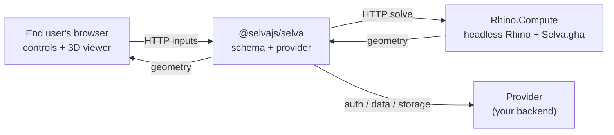

# Architecture

## Four moving parts

| Part                                 | What it is                                     | Runs on                                |
| ------------------------------------ | ---------------------------------------------- | -------------------------------------- |
| **Selva plugin** (`Selva.gha`)       | The schema _designer_ + bridge to a live Rhino | Author's Rhino, and the Compute server |
| **Selva web app** (`@selvajs/selva`) | The schema _runner_                            | Your server                            |
| **Rhino.Compute**                    | Headless Rhino that solves over HTTP           | A Windows VM                           |
| **Provider**                         | Pluggable auth / data / storage backend        | In-process with the web app            |

## The schema is the contract

A **schema** describes a definition's web interface: exposed inputs, their controls, the layout, and the outputs. The designer writes it; the web app reads it. It is defined once in `ui-schema.json` and generated into TypeScript and C#. CI fails on drift.

## Two runtime paths

**Design time.** The plugin runs a WebSocket server inside your Rhino, on loopback (port 8765 by default, a free port if taken). The designer connects, discovers parameters, and writes the schema into the `.gh`.

**Run time.** There is no live Rhino. The web app sends inputs to Rhino.Compute over HTTP on each change and draws the returned geometry in the Three.js viewer.

## The packages

| Package                  | Role                                                                                                                |
| ------------------------ | ------------------------------------------------------------------------------------------------------------------- |
| `@selvajs/schemas`       | The schema contract + TS/C# generators.                                                                             |
| `@selvajs/plugin-ui`     | The schema designer UI, embedded into `Selva.gha`.                                                                  |
| `@selvajs/selva`         | The deployable web app.                                                                                             |
| `@selvajs/ui`            | Svelte components, theme, and viewer shells.                                                                        |
| `@selvajs/compute`       | Type-safe Rhino.Compute client and data trees, no renderer. See [Build your own app](./packages/build/overview.md). |
| `@selvajs/visualization` | Headless viewer core: solve response to Three.js.                                                                   |
| `@selvajs/solve`         | The solve flow, client and server.                                                                                  |
| `@selvajs/server`        | Server building blocks: compute limits, rate limit, SSRF guard, definitions, tokens, access.                        |
| `@selvajs/platform`      | Provider _interfaces_. See [Providers](./self-hosting/providers/overview.md).                                       |
| `@selvajs/*-provider`    | Provider implementations. Each runs a conformance suite.                                                            |
| `@selvajs/cli`           | Scaffolds and operates a deployment. See [CLI](./self-hosting/get-started/cli.md).                                  |

## Next

- [Providers](./self-hosting/providers/overview.md)
- [Get Started](./self-hosting/get-started/overview.md)
- [Build your own app](./packages/build/overview.md)
