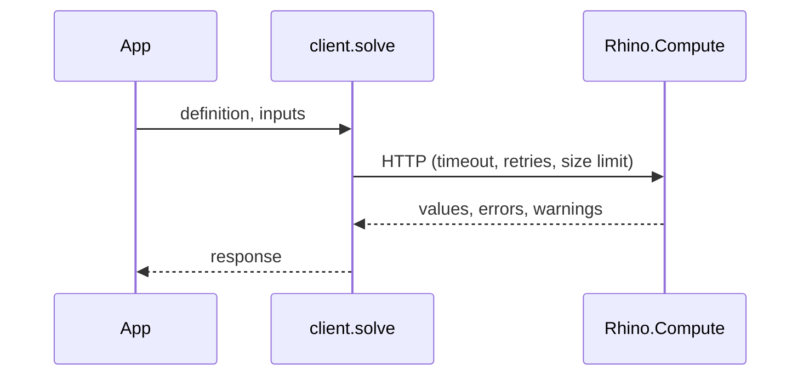

# How the compute client works

`@selvajs/compute` sends a Grasshopper definition (`.gh` file) and input values to Rhino.Compute and returns the outputs. A **solve** is one such request. The **IO** is a definition's inputs and outputs (names, types, defaults, min and max). Both use [data trees](./data-trees.md).

## The five steps

```ts
import {
	GrasshopperClient,
	TreeBuilder,
	GrasshopperResponseProcessor
} from '@selvajs/compute/grasshopper';

// 1. Connect. The client checks the server first, so a wrong URL fails here.
const client = await GrasshopperClient.create({ serverUrl, apiKey });

// 2. Ask the definition what inputs it has.
const io = await client.getIO(definition);

// 3. Build the input values, starting from the defaults.
let inputs = TreeBuilder.fromInputParams(io.inputs);
inputs = TreeBuilder.replaceTreeValue(inputs, 'Radius', 10);

// 4. Solve.
const response = await client.solve(definition, inputs);

// 5. Read the outputs.
const { values } = new GrasshopperResponseProcessor(response).getValues();
```

`definition` is a URL (the server downloads it), the file's bytes as a `Uint8Array` (uploaded as base64), or a `DefinitionRef` that loads bytes only when needed (see [Common tasks](./common-tasks.md#load-definition-bytes-on-demand)). A file path doesn't work: the client sends the path string as the definition.



## `client.solve` or a scheduler?

`client.solve` sends one request. Use it for scripts and one-off jobs.

A UI needs a scheduler (`client.createScheduler(options)`): sliders fire many solves, users leave mid-solve, inputs repeat. Make one per part of your UI.

| You want                              | Use                                        |
| ------------------------------------- | ------------------------------------------ |
| Only the newest slider value to count | `mode: 'latest-wins'`                      |
| Every job to run, in order            | `mode: 'queue'` (`maxConcurrent` for many) |
| Requests not to pile up on a server   | `maxQueueDepth`, `queueWaitMs`             |
| Cancel when a component goes away     | `scheduler.cancelAll()`, or a `signal`     |
| Instant answers for repeated inputs   | `cache: { maxBytes }`                      |
| A spinner                             | `subscribe()`, `isSolving`, `hasPending`   |

When the solver reports errors, `client.solve` **throws** `COMPUTATION_ERROR` and `scheduler.solve` **returns** the response with the errors in it:

```ts
import { readField } from '@selvajs/compute/core';

const response = await scheduler.solve(definition, inputs);
const errors = readField<string[]>(response, 'errors');
if (errors?.length) showError(errors.join('\n'));
```

## Two caches

|           | Response cache                          | Server definition reuse                               |
| --------- | --------------------------------------- | ----------------------------------------------------- |
| Saves     | The whole request                       | Re-uploading the `.gh` file                           |
| Default   | Off. Turn on with `cache: { maxBytes }` | On. Turn off with `reuseServerDefinitionCache: false` |
| On a miss | The solve runs as normal                | The file is uploaded again, automatically             |

Both identify a definition by its content. So:

- Don't change a `Uint8Array` after solving with it. The scheduler remembers its fingerprint and may return old answers.
- A `DefinitionRef` key must identify one exact file, such as a version id, never a file name. It is trusted without looking at the bytes.
- Cached answers are shared, not copied. Treat them as read-only.

`solveDetailed()` reports per call whether the answer came `fromCache` and whether the file was re-uploaded.

## In a browser

The server URL and API key you give the client are visible to every visitor. Call Compute from your backend or a proxy. The server must also allow CORS, which stock Rhino.Compute doesn't (see the package README). `suppressBrowserWarning` silences the browser warning.

## What needs the VektorNode fork

Plain solving works with stock Rhino.Compute. Input groups, input ids, file outputs and block instances need the [VektorNode fork](https://github.com/VektorNode/compute.rhino3d), and some also need the Selva plugin. The API reference marks each one.
