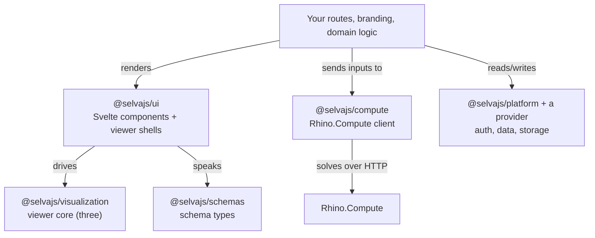

# Build your own app

Everything the standalone `@selvajs/selva` app does also ships as npm packages. Use them for your own branding, routes and domain model, with Selva doing the parametric work.

## The model



Take only the boxes you need. For the viewer and solving, install `@selvajs/ui`. It peer-depends on `compute`, `visualization`, `solve`, `schemas`, `three`, `@sveltejs/kit`, `bits-ui`, `svelte` and `tailwind-variants`.

```bash
pnpm add @selvajs/ui @selvajs/visualization @selvajs/solve @selvajs/compute @selvajs/schemas three bits-ui tailwind-variants
```

The [packages page](https://selva.dev/packages) lists every `@selvajs/*` package with its README, the reference for its API. Backends: [Providers](../../self-hosting/providers/overview.md).

## The compute client

[`@selvajs/compute`](https://www.npmjs.com/package/@selvajs/compute) talks to Rhino.Compute. It has no renderer and no `three` dependency. It runs in the browser and Node, reads and writes Grasshopper **data trees**, and throws errors you can narrow on.

Import from `/grasshopper` or `/core`. There is no root entry.

To turn a response into Three.js objects, use [`@selvajs/visualization`](https://www.npmjs.com/package/@selvajs/visualization) (`/scene`, `/render`, `/parse`).

Read next: [How it works](./how-it-works.md), [Data trees](./data-trees.md), [Errors and retries](./errors.md), [Common tasks](./common-tasks.md). Full API: <https://selva.dev/docs/api/compute/>. How the pieces relate to the plugin: [Architecture](../../architecture.md).
