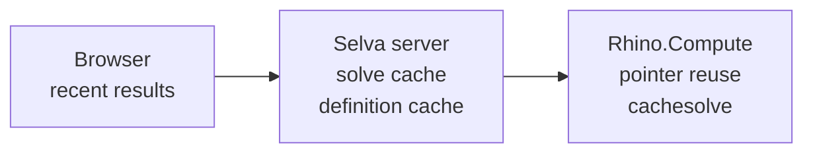

# Caching

Solving a Grasshopper definition is the expensive part of Selva. Caches avoid repeating the solve,
re-uploading the definition, and re-reading it from storage.

Two settings control Selva's own caches. Both are sizes in MB, both are on by default, and `0` turns one off.

| Name                 | Holds                                       | Setting                       |
| -------------------- | ------------------------------------------- | ----------------------------- |
| **Definition cache** | `.gh` file bytes                            | `COMPUTE_DEFINITION_CACHE_MB` |
| **Solve cache**      | solve results, keyed on definition + inputs | `COMPUTE_SOLVE_CACHE_MB`      |

## Overview

A request checks each layer in turn and stops at the first hit.

| Cache            | Runs in         | Skips                              | Configurable |
| ---------------- | --------------- | ---------------------------------- | ------------ |
| Recent results   | Browser         | the whole round-trip               | no           |
| Solve cache      | Selva server    | the network call **and** the solve | yes          |
| Definition cache | Selva server    | reading the `.gh` from storage     | yes          |
| Pointer reuse    | Selva ↔ Compute | re-uploading the `.gh`             | yes          |
| `cachesolve`     | Rhino.Compute   | the solve                          | yes          |

The viewer keeps no geometry, texture, or edge cache between solves. It rebuilds its scene each time.
Two more mechanisms need no configuration: see [Caches you don't configure](#caches-you-dont-configure).

---

## Why you rarely need to clear a cache

Publishing a definition gives it a new version id, and entries key on that id. A new version lands
under keys nothing has used, so nothing needs clearing. Old entries age out, and a rollback re-hits
the old ones.

Only two caches discard entries on purpose: recent browser results clear when you switch definition,
and the warm-client cache drops a server when its URL or API key changes.

Two situations leave entries lingering. Neither causes wrong output.

1. **You delete a definition.** Its definition-cache entries sit in memory until the byte budget
   evicts them. Nothing can reach them.
2. **You upgrade Rhino in place on an existing compute server.** The solve cache lives per warm
   compute client, so results from the old Rhino survive.

### Clearing one anyway

`/admin/compute` has a **Clear** button on the solve-cache and definition-cache panels. It empties
that cache on the Selva instance serving the request. Behind a load balancer the other instances keep
theirs, so a fleet-wide clear means a restart.

Use it in the two cases above, or when a definition reads outside its inputs (see the solve cache
warning below). Clearing costs a re-solve or a storage re-read, never correctness.

The per-server **Purge** button is separate: it clears Rhino.Compute's own `cachesolve`. Selva's solve
cache sits in front of it, so purging alone won't give a fresh solve.

---

## The result caches, one at a time

### Recent results (browser)

Holds the last **16** solve results, looked up by input values. Dragging a slider back to a value you
already solved returns instantly with no request.

- Per browser tab. Gone on reload.
- Cleared when the active definition changes. Not configurable.

### Solve cache (Selva server)

Returns the stored result when the same definition with the same inputs was already solved on this
process, without calling Rhino.Compute.

- Lives in one process's memory. Lost on restart, not shared across instances.
- **Limit:** `COMPUTE_SOLVE_CACHE_MB`, default 256 MB.
- **No timer expiry.** When the budget is exceeded, the least recently used entries go first. The same
  definition and inputs always give the same result, so a kept entry can't go stale.
- **Warning: definitions that read outside their inputs** (a live URL, a database, the clock). Their
  output isn't a function of their inputs, so a cached result can be wrong. Nothing detects this.
  Clear the cache or restart.
- **Warning: the budget is per compute server**, and Selva keeps up to 16 warm. The worst case is
  `256 MB × 16`. Lower `COMPUTE_SOLVE_CACHE_MB` if you run several compute servers on a small host.

### Definition cache (Selva server)

Holds `.gh` bytes so a re-solve doesn't re-read a multi-MB file from disk or S3. With pointer reuse, a
warm re-solve moves no definition bytes.

- **Limit:** `COMPUTE_DEFINITION_CACHE_MB`, default 256 MB.

A definition reaches a solve from one of two sources, and only one can go stale:

| Source                           | Keyed on                  | Re-read after | Why                                      |
| -------------------------------- | ------------------------- | ------------- | ---------------------------------------- |
| **Uploaded** to Selva            | version id (never reused) | never         | a published version's bytes never change |
| **Remote URL** (`definitionUrl`) | the URL                   | 5 min         | whoever owns the URL can swap the file   |

The 5 minutes is `REMOTE_DEFINITION_CACHE_TTL_MS`. It applies only to remote URLs.

### Pointer reuse (how the definition is sent)

Not a result cache. Selva uploads the `.gh` once, gets a key back, and sends only the key afterwards.

- The only cache that helps while inputs keep changing, such as slider scrubbing on a large definition.
- Doesn't skip the solve, only the upload.
- If the server forgot the key, Selva re-uploads automatically.
- **Warning:** auto-recovery needs a server that reports a forgotten key correctly (the VektorNode
  fork does). On a Rhino.Compute server you don't control, a forgotten key could return empty
  geometry. Set `COMPUTE_REUSE_DEFINITION_CACHE=false`.

### `cachesolve` (Rhino.Compute)

Asks the compute server to remember results, keyed on definition + inputs.

- Lives on the compute box (memory and disk), so it survives Selva restarts and is shared by every
  Selva instance using that server.
- Still costs a network round-trip. Heaviest memory and disk cost of any cache here.
- Errored solves are never cached unless explicitly opted in.
- **Purge** at `/admin/compute`. One `POST /cache/purge` reaches only one of the server's Rhino child
  processes, so Selva loops the call across the round-robin pool and reports how many it reached. If
  it can't be sure it covered every child, the result is labelled best-effort.

---

## Caches you don't configure

None has settings and none can serve stale content.

| Cache                  | Runs in      | Keyed on                     | Bound                   |
| ---------------------- | ------------ | ---------------------------- | ----------------------- |
| Warm-client cache      | Selva server | compute server id            | 16 servers              |
| Single-flight          | Selva server | definition + server + inputs | only while a solve runs |
| Shared edge extraction | Browser      | mesh content hash            | only while it runs      |

- **Warm-client cache** keeps a connected client per compute server instead of reconnecting each
  solve. It drops a server when you change its URL or key.
- **Single-flight.** Identical solves arriving together run once and share the result, so a popular
  public definition doesn't send compute a hundred copies of the same work after a deploy. Nothing is
  stored. It runs for every solve, which matters most when the solve cache is off.
- **Shared edge extraction.** When several meshes in one solve are identical, their edges are
  computed once. It applies only to concurrent extractions large enough to go to a worker.

---

## Where to change settings

Server-side, in [`packages/selva/.env.example`](https://github.com/VektorNode/selva/blob/main/packages/selva/.env.example) (copy to `.env`).
Defaults and parsing live in [`packages/server/src/compute/limits.ts`](https://github.com/VektorNode/selva/blob/main/packages/server/src/compute/limits.ts).
Restart the Selva server after editing.

**Selva's caches:**

| Setting                       | Cache            | Default | What it does                                                                     |
| ----------------------------- | ---------------- | ------- | -------------------------------------------------------------------------------- |
| `COMPUTE_DEFINITION_CACHE_MB` | Definition cache | `256`   | How much `.gh` data to keep. `0` disables.                                       |
| `COMPUTE_SOLVE_CACHE_MB`      | Solve cache      | `256`   | How many results to keep, **per compute server** (×16 worst case). `0` disables. |

**Rhino.Compute flags** (the remote server's features, not Selva's caches):

| Setting                          | Default  | What it does                                                       |
| -------------------------------- | -------- | ------------------------------------------------------------------ |
| `COMPUTE_REUSE_DEFINITION_CACHE` | `true`   | Send a pointer instead of re-uploading the `.gh`.                  |
| `COMPUTE_SERVER_CACHESOLVE`      | `true`   | Let Rhino.Compute cache and return solve results.                  |
| `REMOTE_DEFINITION_CACHE_TTL_MS` | `300000` | Freshness bound on `.gh` bytes fetched from a **remote URL** only. |

**Renamed vars.** `COMPUTE_DEFINITION_BYTE_CACHE_MB` → `COMPUTE_DEFINITION_CACHE_MB`,
`COMPUTE_RESPONSE_CACHE_MB` → `COMPUTE_SOLVE_CACHE_MB`, `DEFINITION_CACHE_TTL_MS` →
`REMOTE_DEFINITION_CACHE_TTL_MS`. Each old name still works for one minor version and warns at boot.
`SOLVE_CACHE_PROVIDER`, `SOLVE_CACHE_DEFAULT_MAX_ENTRIES` and `SOLVE_CACHE_MAX_TOTAL_MB` are gone.

---

## Which should I turn on?

The defaults suit most deployments. The settings exist to turn a cache _down_ on a constrained host.

| Situation                                                      | Do this                                                                        |
| -------------------------------------------------------------- | ------------------------------------------------------------------------------ |
| Large `.gh` files, lots of slider scrubbing                    | Defaults. Pointer reuse helps; result caches can't.                            |
| Public configurator, few fixed presets, **multiple instances** | Rely on `cachesolve`. It is the one tier that survives an instance going cold. |
| Compute server memory-constrained, large outputs               | `COMPUTE_SERVER_CACHESOLVE=false`. Its stored results are the heaviest cost.   |
| Many compute servers on a small Selva host                     | Lower `COMPUTE_SOLVE_CACHE_MB` (per server, ×16 worst case).                   |
| Pointed at a Rhino.Compute server you don't control            | `COMPUTE_REUSE_DEFINITION_CACHE=false`.                                        |

---

## How to tell a cache is working

**Start at `/admin/compute`.** The Caching panel shows a live hit rate for the solve and definition
caches, with entry and byte counts. A rate that climbs while you scrub a slider is working. A rate
stuck at 0% means every solve reaches Rhino. `—` means nothing has consulted that cache yet.

Counters are per Selva instance and reset on restart.

For one request, read the `Server-Timing` header on the solve response:

| What you see                                      | Means                                                             |
| ------------------------------------------------- | ----------------------------------------------------------------- |
| No request in the network panel                   | The browser had the result and answered itself.                   |
| `selva_cache;dur=1`                               | Solve cache hit; Selva answered without calling Rhino.            |
| `selva_cache;dur=0`                               | Solve cache miss; the request went to Rhino.                      |
| `def_bytes;desc=hit`                              | Definition cache hit; no storage read.                            |
| `def_bytes;desc=miss`                             | Definition cache miss; the `.gh` was read from storage.           |
| `def_bytes;desc=skipped`                          | A pointer-known re-solve moved no bytes.                          |
| `def_reupload;dur=1`                              | The server had forgotten the pointer, so the `.gh` went up again. |
| `solve` time near zero, but a round-trip happened | `cachesolve` hit on the compute server.                           |
| Small outgoing body carrying a `pointer`          | Pointer reuse is working.                                         |

For more detail set `SELVA_FLAG_COMPUTE_DEBUG=on` (`off` | `on` | `verbose`). The server then logs a
per-solve phase breakdown, running definition-cache hit/miss/dropped counts, and each time a solve
joins one already running. The old `SELVA_FLAG_COMPUTE_DEBUG_VERBOSE=true` is still read as `verbose`;
`selva migrate` leaves it alone, so rename it by hand when `selva doctor` reports it.
