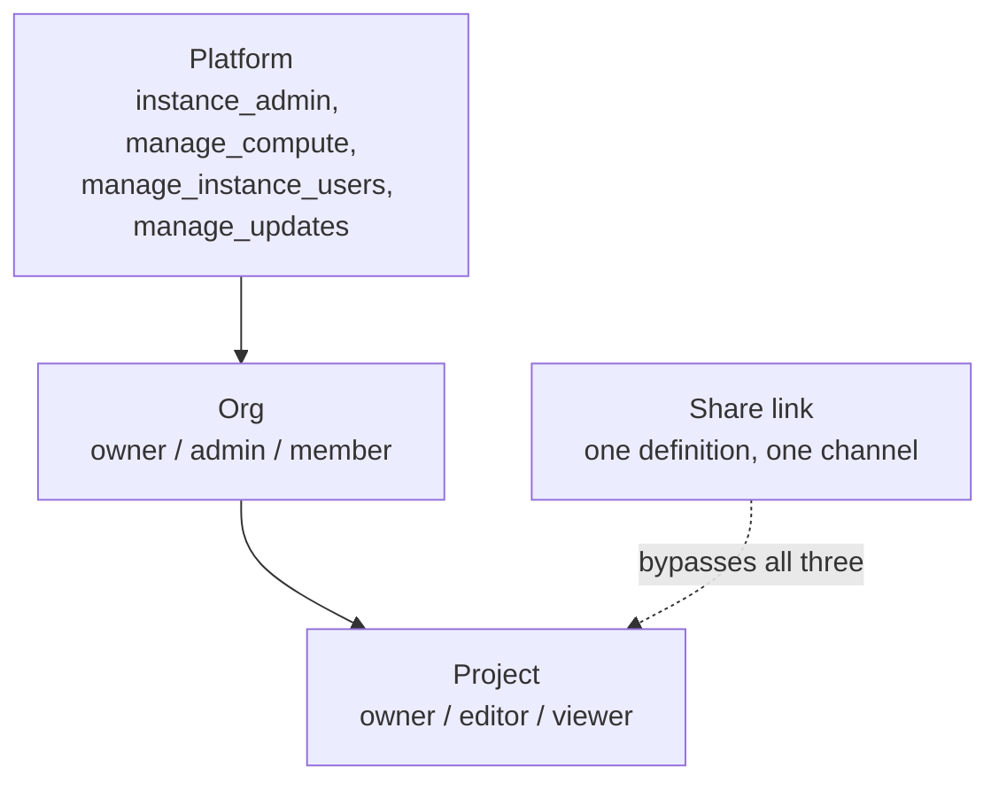

# Permissions & Organizations

Authorization has three independent scopes: **platform**, **org**, and **project**. **Share links**
sit outside them and carry their own access in the link. A user's identity (`id`, `email`) carries no
permissions. Every grant lives in a store keyed by user id, so an external identity provider never has
to model Selva's authorization.

## User vs. member

A **user** is an identity that can sign in: an id, an email, and any platform permissions. It belongs
to the instance. Deleting one is irreversible and erases their data everywhere. Managed at
`/admin/users`, behind `manage_instance_users`.

A **member** is one user's role and permissions _inside one org_. The same user can own one org and
be a plain member of another, so a role belongs to the pairing, not the person. Removing a member
drops that row and leaves the account alone. Managed at `/team/members`, behind `manage_org_members`.

- Anything scoped to an org (role, org permissions, invites) is member vocabulary, even when you reach
  it from the admin side. `/admin/users` shows a user's role in the acting org read-only and links to
  Members & roles to change it.
- Admitting an identity and granting access are separate steps. Where an external IdP owns the
  credential there is nothing to invite, so an admin allowlists the email. Elsewhere the person is
  invited and sets their own password. Either way they arrive as a bare `member` with no permissions.

## Platform scope

Platform permissions are instance-wide operator authority.

| Permission              | Grants                                          |
| ----------------------- | ----------------------------------------------- |
| `instance_admin`        | Superuser; bypasses every other platform check. |
| `manage_compute`        | Configure the instance-wide Rhino.Compute pool. |
| `manage_instance_users` | Create, delete, and enable/disable any user.    |
| `manage_updates`        | Run system updates and switch release channel.  |

Holding any one gets you into `/admin`. Org permissions don't, even those starting with `manage_`.

The data layer refuses any action that would leave the instance with zero enabled `instance_admin`
users, even when the UI is bypassed.

`instance_admin` is a bypass applied at each call site, not a set that expands into the other three.
It skips _management_ checks such as org governance and project admin, but not _content_ checks:
platform staff must use "Reclaim" to touch a project's content, which leaves an audit trail.

## Org scope (multi-tenant)

In multi-org mode each org is a tenant with a unique slug, members, and an owner. The owner is
transferable; the creator is immutable.

| Role     | Default permissions       |
| -------- | ------------------------- |
| `owner`  | All four org permissions. |
| `admin`  | All four org permissions. |
| `member` | None.                     |

The org permissions are `manage_org_members`, `manage_org_compute`, `manage_definitions`, and
`manage_projects`. The first two are governance permissions and **can never be granted to a
`member`**. The role is a summary; the permission set is what gets checked.

Deleting an org marks it, its members, projects, and project members deleted rather than erasing
rows. Pending invites and the org's compute config are removed outright.

## Project scope

Projects belong to an org. Each has a visibility and a role per member.

- **Roles:** `owner`, `editor`, `viewer`. Owners can delete the project, manage members, and change
  settings. Owners and editors edit definitions. Everyone in scope can view and solve.
- **Visibility:**
  - `private`: listed members only
  - `org`: any org member
  - `public`: org members by default, any authenticated user when `SELVA_FLAG_ALLOW_CROSS_ORG_PUBLIC`
    is on
  - `platform`: managed by instance admins, access via platform-project grants

Removing a project's sole owner is blocked. One owner removing another needs confirmation.

**Platform projects** are cross-org. Access comes from an explicit grant to an org or a user, each with
a `canSolve` flag (`false` means view-only). Membership of the host org grants nothing by itself. With
`SELVA_FLAG_ENABLE_PLATFORM_PROJECTS` off they are inaccessible **even to instance admins**, and
`/admin/projects` 404s.

## Invites

A member with `manage_org_members` invites an email into their org at a chosen role. The invite
carries the org, role, and org permissions. Governance permissions are stripped from `member`
invites; owner and admin invites get the full default set. Invites expire after **7 days**.

Anyone holding the raw token can accept; nothing else is checked. Selva shows the token once and
stores only a hash. The acceptance page (`/accept-invite`) works without a session. Accepting creates
the user (by password or upstream-header identity) and adds them to the org, with **no platform
permissions**.

Orgs are created at setup or by an instance admin. There is no self-service creation.
`SELVA_FLAG_ALLOW_ORG_CREATION` is shown read-only on `/admin/system`, but no route reads it, so
setting it does nothing.

## Share links

A share link gives account-free access to one definition on one channel, live or draft. It bypasses
org and project authorization.

- `allowSolve: false` grants view and schema access only. `true` allows solving.
- `maxSolves` caps total solves. Default **1000**; `null` removes the cap. The counter increments
  atomically, so two simultaneous solves can't both take the last slot. Over the cap returns **429**.
- `expiresAt` is optional.
- Revoking marks the link dead instead of deleting it. Revoking twice is harmless.

Minting and revoking take the same authority as uploading the definition (`canEditDefinition`).
`SELVA_FLAG_ENABLE_SHARING` gates the feature. Turning it off blocks the admin routes and stops
honouring existing tokens.

## Single vs. multi-tenant

`tenancy: 'single'` collapses the org scope: setup creates one org and every authenticated user acts
in it. `tenancy: 'multi'` makes orgs first-class: setup creates only the platform admin, and users
create orgs from there. The two modes create that first admin differently; see
[the admin guide](../deployment/admin.md#first-run-setup).

## Next

- [Admin guide](../deployment/admin.md): where these grants are managed day to day.
- [Providers](../providers/overview.md): which store backs each grant.
