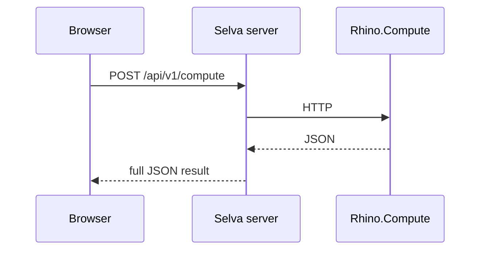

# Scaling

## How a solve flows

- The browser never reaches Rhino.Compute. The Selva server holds its URL and API key.
- The `.gh`, inputs and result are buffered whole in Node memory and serialized with one blocking `JSON.stringify`. V8 caps a string near 512 MB, hence the 300 MB `COMPUTE_RESPONSE_MAX_BYTES`.
- File and geometry data travels as base64 in JSON (about 4/3 larger).
- Each definition pins to one compute server (no load balancing), with its own in-process FIFO queue. Pointer reuse and `cachesolve` are per server ([Caching](../concepts/caching.md)).
- `Server-Timing` and solve metrics show which limit you hit. Measure first.

### What breaks first

| #   | Bottleneck                                            | Symptom                                                     |
| --- | ----------------------------------------------------- | ----------------------------------------------------------- |
| 1   | `JSON.stringify` of ~100 MB bodies on the main thread | One big solve stalls every request on the Node server       |
| 2   | Base64 file outputs                                   | ~1 GB tab memory per solve; server hits the V8 string limit |
| 3   | One compute server per definition                     | Queue buildup                                               |
| 4   | Synchronous request, 100 s deadline                   | Long solves impossible; connections held open               |
| 5   | In-process queue and caches                           | A second Selva instance can't share them                    |

## Scale one server first

`rhino.compute` round-robins across `compute.geometry` children, each a full headless Rhino:

- `--childcount`: children (default 4, cap 64).
- `--idlespan`: seconds before an idle child exits and stops billing (default 3600).
- `--spawn-on-startup`: pre-warm children.

Max out cores and children on one VM before adding VMs. Raise `RHINO_COMPUTE_MAX_REQUEST_SIZE` (about 50 MB by default, like `MAX_DEFINITION_FILE_SIZE_BYTES`) for large payloads.

## Cost

[Core-hour billing](https://developer.rhino3d.com/guides/compute/core-hour-billing/) is $0.10 per core per hour on Rhino uptime, not usage: an idle 8-core VM is about $576 a month. One `RHINO_TOKEN` licenses the whole fleet; keep it secret, it bills your card. To cut cost, use `--idlespan` and stop VMs.

## Caching and networking

- With unique outputs a result cache rarely hits. Check the `selva_cache` Server-Timing metric and the `/admin/compute` caching panel before adding one.
- Keep compute servers, the Selva server and storage in one VPC and region. The Selva-to-compute hop carries the largest payloads.
- The plugin WebSocket stays on loopback. Under Supabase the server is nearly stateless; the local provider is single-instance by design.

## Running a second instance

The queue, warm-client LRU, caches and rate limiter live in process. Split caches only lose hit rate. **The rate limiter multiplies**: N instances enforce N times `COMPUTE_RATE_LIMIT_MAX`. Size it for that or move the limiter to a shared store.
