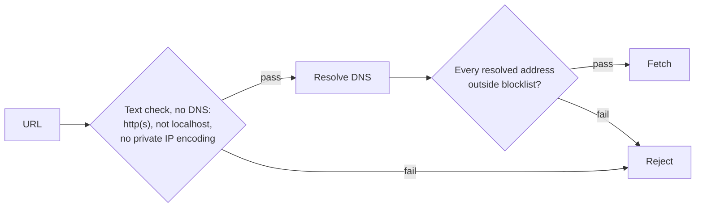

# Security & Limits

[`.env.example`](https://github.com/VektorNode/selva/blob/main/packages/selva/.env.example) is the authoritative env-var list. Caps resolve once at boot (`packages/server/src/compute/limits.ts`); an invalid value warns and falls back to the default. `MB = 1024 × 1024`.

## Rate limiting

All limiters use a fixed window and keep counts in memory, so N instances enforce roughly N times the limit. Over the limit returns **429**.

### Compute solves (`/api/v1/compute`)

| Env var                        | Default  | Meaning            |
| ------------------------------ | -------- | ------------------ |
| `COMPUTE_RATE_LIMIT_WINDOW_MS` | `100000` | Window length.     |
| `COMPUTE_RATE_LIMIT_MAX`       | `120`    | Solves per window. |

Keyed by `user:<id>` or, for share-token solves, `share:<linkId>`, so anonymous link traffic never uses the owner's budget. The response carries `Retry-After`.

### API tokens (`/api/v1`)

| Env var                          | Default | Meaning                                    |
| -------------------------------- | ------- | ------------------------------------------ |
| `API_TOKEN_RATE_LIMIT_WINDOW_MS` | `60000` | Window length.                             |
| `API_TOKEN_RATE_LIMIT_MAX`       | `600`   | Requests per token per window; `0` is off. |

Keyed per token; browser sessions are not charged. A token solve also draws on its owner's compute bucket, so extra keys buy no extra compute. Responses carry `RateLimit-Limit` and `RateLimit-Remaining`, and `RATE_LIMITED` plus `Retry-After` when over.

### Login and share links

- **Login:** 5 failed attempts per 15 minutes per client IP. Fixed, not configurable. A success resets the count.
- **Share links:** each link has a `maxSolves` counter, checked atomically before every solve. When exhausted, the solve returns **429**.

## Size, concurrency and queue caps

| Env var                              | Default              | Guards                                                                                               |
| ------------------------------------ | -------------------- | ---------------------------------------------------------------------------------------------------- |
| `COMPUTE_SOLVE_DEADLINE_MS`          | `100000`             | Longest single solve before abort. Replaces `MAX_SOLVE_DURATION_MS`, which still works and warns.    |
| `COMPUTE_MAX_QUEUE_DEPTH`            | `0` (unbounded)      | Max queued solves. A full queue returns **503** + `Retry-After`.                                     |
| `COMPUTE_QUEUE_WAIT_MS`              | `0` (none)           | Max queue time before **503**.                                                                       |
| `MAX_DEFINITION_FILE_SIZE_BYTES`     | `52428800` (50 MB)   | `.gh` uploads and remote-definition fetches.                                                         |
| `MAX_IMAGE_FILE_SIZE_BYTES`          | `10485760` (10 MB)   | Cover-image uploads.                                                                                 |
| `COMPUTE_REQUEST_MAX_BYTES`          | `268435456` (256 MB) | `/api/v1/compute` request body. Keep ≤ `BODY_SIZE_LIMIT`.                                            |
| `COMPUTE_RESPONSE_MAX_BYTES`         | `314572800` (300 MB) | `/api/v1/compute` response, under Node's ~512 MB string limit. Over returns **413**.                 |
| `REMOTE_DEFINITION_FETCH_TIMEOUT_MS` | `30000`              | Remote-definition fetch deadline.                                                                    |
| `BODY_SIZE_LIMIT`                    | `256M`               | adapter-node body cap on every route. Use `256M` or raw bytes: `256mb` and `Infinity` throw on boot. |

Concurrency is not an env var. Selva reads the compute server's active child count at connect and after solves, and falls back to `1` if the probe fails or reports `0`. Change it with `--childcount` on the compute server. Cache budgets are in [Caching](../concepts/caching.md).

## Guard on remote-definition URLs

A user-supplied definition URL could point at your internal network or the cloud metadata endpoint (SSRF). `packages/server/src/compute/safe-url.ts` checks before any fetch:

Blocked: `0.0.0.0/8`, loopback, `10/8`, `172.16–31`, `192.168/16`, `fc00::/7`, and link-local (`169.254/16` including `169.254.169.254`, `fe80::/10`). Every rejection returns the same `Remote definition URL is not allowed`; the reason is logged server-side. DNS rebinding between check and fetch is not closed. Rhino.Compute _server_ URLs skip this guard: admins set them in `/admin/compute`.

## Who can put code on Compute

A definition's script components (C#, Python, VB) run on the Compute server with its process rights, on upload and every solve. Anyone who gets a definition onto Compute can run code there:

- **Anyone who can create a definition** (project owners and editors; on a commons project, anyone who reaches it).
- **Anyone with an API token scoped `upload` or `write`**, such as the Grasshopper plugin ([Signing in from apps](../../packages/build/signing-in-from-apps.md)). A token reaches only what its owner could from the browser.
- **Anyone who can solve a remote definition**: any signed-in user or org-wide `solve` token can pass a `definitionUrl`. The [URL guard](#guard-on-remote-definition-urls) protects your network, not Compute from the file's scripts.

Selva doesn't sandbox scripts. Run Compute on its own machine with an unprivileged account, no Selva database credentials, `SELVA_*` keys or cloud credentials, and only the network access definitions need.

## Secrets

Two required keys, generated by `npx @selvajs/cli` at scaffold time.

| Key                 | Protects                                                                 | Format                                               | Rotating it…                                                           |
| ------------------- | ------------------------------------------------------------------------ | ---------------------------------------------------- | ---------------------------------------------------------------------- |
| `SELVA_HMAC_KEY`    | Signs session cookies; hashes share-link and invite tokens.              | ≥ 32 characters.                                     | Logs everyone out; invalidates all share links and pending invites.    |
| `SELVA_AT_REST_KEY` | AES-256-GCM encryption of the Rhino.Compute API key (on disk and in DB). | 64-char hex, or base64 decoding to exactly 32 bytes. | Stored API key becomes undecryptable; re-enter it at `/admin/compute`. |

Under `supabase`, sessions are Supabase JWTs, so the HMAC key only hashes tokens. `SupabaseDataProvider` refuses to start without the at-rest key. A key mismatch is caught at boot and shown in admin system health. The at-rest key guards against leaked backups, not an attacker inside the running process.

The keys are separate so `selva keys rotate hmac` can answer a session-secret leak without taking compute offline. Don't reuse the same bytes for both.

### What rotating `SELVA_HMAC_KEY` breaks

Takes effect on restart. Nothing errors; items just stop being found:

- **Sessions (local provider only):** everyone signs in again.
- **Share links:** read as invalid. Mint new ones.
- **Pending invites:** read as "invalid or has expired". Re-send. Accepted invites are unaffected.

Dead link and invite rows stay in the store, harmless. Accounts, passwords, memberships, projects, definitions and files are untouched.

## Cookies and transport

- **Cookies** are `Secure`, `httpOnly` and `sameSite=lax` in production. `ALLOW_INSECURE_COOKIES=true` drops `Secure` for HTTP-only deployments. It is not in `.env.example`; without it, login over plain `http://` silently fails.
- **`ORIGIN`** must be your public address when behind a proxy (`https://your-domain.com`, no trailing slash). Otherwise form POSTs fail with "Cross-site POST form submissions are forbidden".
- **`HOST`** defaults to `0.0.0.0`. Under header-auth the app **must** be reachable only through the trusted proxy (bind `127.0.0.1`), and the proxy must authenticate every request and **overwrite** inbound `SELVA-*` headers. Selva never strips them and doesn't check at runtime.

## Logging and personal data

`PinoLogger` redacts by field name only. Top level: `token`, `sessionToken`, `refreshToken`, `apiKey`, `api_key`, `password`, `authorization`, `Authorization`, `cookie`, `secret`. One level down, the same minus `api_key` and `cookie`. Nothing deeper, no personal data such as emails, and nothing at all when `pino` isn't installed (console fallback). Log identifiers (`eventType`, `actorId`, `userId`), never whole objects: logs are where erasure can't reach. See [data privacy](../concepts/data-privacy.md).
