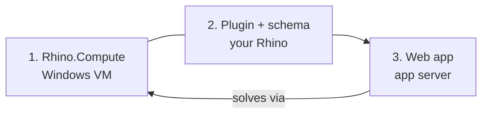

# Get Started

Going live takes three steps on two machines: a Windows **Compute server** running headless Rhino, and an **app server** (any host that runs a long-lived Node process).



To try it first, [Local Dev Setup](./quick-start.md) runs the app on your laptop. Solving still needs a Compute server.

## 1. Rhino.Compute

Install the [VektorNode fork](https://github.com/VektorNode/compute.rhino3d), Selva, and your definitions' plugins, the last two **under the `rhino.compute` account**. See [Rhino Compute Setup](./rhino-compute.md).

## 2. Plugin + schema

1. Install **Selva** from the Grasshopper Package Manager and restart Rhino.
2. Drop the Selva UI Builder onto your definition and open the designer.
3. Drag inputs into controls, lay them out, save. The schema is written into the `.gh`.

## 3. Deploy the web app

```bash
npx @selvajs/cli my-deployment   # prompts for provider, origin, tenancy
cd my-deployment
npm run doctor                   # validates the config
npm start                        # runs under pm2
```

Open `/setup` to create the admin account, register your Compute server at `/admin/compute`, upload a definition, share the link.

Auth, data, and storage default to the `local` provider, which needs no setup. See [Providers](../providers/overview.md), [CLI](./cli.md), [Deployment prerequisites](../deployment/prerequisites.md).

## 4. (Optional) Build your own app

Use the `@selvajs/*` packages directly. See [Build your own app](../../packages/build/overview.md).
