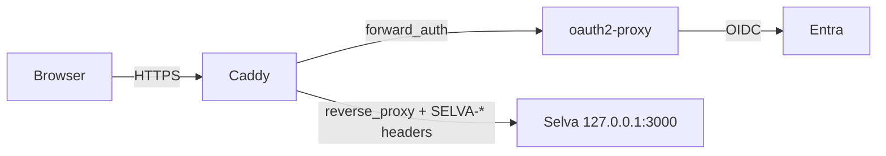

# Header-auth (Entra, Okta, Google Workspace…)

`@selvajs/header-auth-provider` is an **auth-only** adapter that trusts identity headers set by a reverse proxy (Caddy `forward_auth`, oauth2-proxy, Authelia) in front of Selva. Pair it with [`local`](./local.md) or [`supabase`](./supabase.md) for data and storage.

## ⚠ Security: the deployment IS the boundary

The provider does **no cryptographic verification.** The proxy is the only thing between a stranger and an admin session, and nothing at runtime catches a misconfiguration.

**Read the [`@selvajs/header-auth-provider` README](https://github.com/VektorNode/selva/blob/main/packages/providers/header-auth/README.md) before deploying.** It owns the three requirements (network isolation, proxy-side auth, header scrubbing), the header names, env vars, bootstrap policy, and self-test. This page shows one way to meet them with Entra.

## Prerequisites

Selva running behind a [reverse proxy](../deployment/reverse-proxy.md) (see [Prerequisites](../deployment/prerequisites.md) and the [CLI guide](../get-started/cli.md)), and a domain with an A record pointing at the host.

## Entra SSO via oauth2-proxy + Caddy



Replace `[your-domain]`, `corp.com` and `admin@corp.com` throughout.

### Part 1: Entra app registration

1. **App registrations → New registration** (single tenant). Copy the **Application (client) ID** and **Directory (tenant) ID**.
2. **Certificates & secrets → New client secret.** Copy the value now; it is shown once.
3. **Authentication → Add platform → Web** (not SPA). Redirect URI, exact, no trailing slash:
   ```
   https://[your-domain]/oauth2/callback
   ```

The default `User.Read` permission is enough. Note the client secret's expiry date: when it passes, nobody can sign in until it's rotated (Day-2).

### Part 2: Install oauth2-proxy

Download a [release](https://github.com/oauth2-proxy/oauth2-proxy/releases), v7.15.5 or later. Earlier versions keep a session going after Entra refuses to refresh it, or write session cookies to the log ([GHSA-hhqp-vx7f-5c6m](https://github.com/oauth2-proxy/oauth2-proxy/security/advisories/GHSA-hhqp-vx7f-5c6m)). Put the binary at `/usr/local/bin/oauth2-proxy`, and generate a cookie secret:

```bash
python3 -c 'import os,base64;print(base64.urlsafe_b64encode(os.urandom(32)).decode())'
```

### Part 3: oauth2-proxy config

`/etc/oauth2-proxy.cfg`, readable by oauth2-proxy alone (Part 4):

```ini
provider = "oidc"
oidc_issuer_url = "https://login.microsoftonline.com/<TENANT_ID>/v2.0"
client_id = "<CLIENT_ID>"
client_secret = "<SECRET_VALUE>"
cookie_secret = "<COOKIE_SECRET>"

http_address = "127.0.0.1:4180"
reverse_proxy = true
redirect_url = "https://[your-domain]/oauth2/callback"

oidc_email_claim = "preferred_username"
email_domains = ["corp.com"]
set_xauthrequest = true
skip_provider_button = true

scope = "openid email profile offline_access"
cookie_refresh = "15m"
cookie_expire = "12h"
cookie_secure = true
cookie_samesite = "lax"
```

- **`cookie_refresh` is how long a disabled user keeps browser access.** oauth2-proxy refreshes the session with Entra every 15 minutes while someone uses Selva, and ends it once Entra refuses. `offline_access` needs nothing in Entra: Microsoft grants it along with any other delegated permission. Without `cookie_refresh`, oauth2-proxy never asks Entra again until the cookie runs out.
- **`cookie_expire`** caps a session at 12 hours, so people go back through Entra about once a working day, usually without a prompt.
- **`email_domains`** lists your users' UPN domains. It keeps guest accounts from other tenants out of the proxy.
- **No `cookie_domains`.** Without it the session cookie stays on this host; with it, every subdomain receives it.
- **`cookie_secret` signs every session.** Anyone who has it can sign in as anyone.

### Part 4: oauth2-proxy as a service

`/etc/systemd/system/oauth2-proxy.service`:

```ini
[Unit]
Description=oauth2-proxy
After=network.target

[Service]
ExecStart=/usr/local/bin/oauth2-proxy --config=/etc/oauth2-proxy.cfg
Restart=always
User=oauth2-proxy

[Install]
WantedBy=multi-user.target
```

```bash
sudo useradd --system --no-create-home --shell /usr/sbin/nologin oauth2-proxy
sudo chown root:oauth2-proxy /etc/oauth2-proxy.cfg
sudo chmod 640 /etc/oauth2-proxy.cfg
sudo systemctl daemon-reload
sudo systemctl enable --now oauth2-proxy
```

A user of its own keeps `cookie_secret` and `client_secret` away from the web server's other processes.

### Part 5: Caddyfile

```caddyfile
[your-domain] {
    encode gzip

    # Strip spoofable identity headers at site scope, before any route runs.
    request_header -SELVA-UserPrincipalName
    request_header -SELVA-Email
    request_header -SELVA-DisplayName
    request_header -X-Auth-Request-User
    request_header -X-Auth-Request-Email
    request_header -X-Auth-Request-Preferred-Username

    # oauth2-proxy's own endpoints bypass forward_auth.
    handle /oauth2/* {
        reverse_proxy 127.0.0.1:4180 {
            header_up X-Real-IP {remote_host}
        }
    }

    # Requests Selva authenticates itself skip forward_auth: anything carrying a
    # Selva API key, the MCP endpoint, and the OAuth endpoints MCP clients call
    # server-to-server. /oauth/authorize is not listed: it needs your sign-in.
    @selfAuthenticated {
        header Authorization "Bearer selva_*"
    }
    handle @selfAuthenticated {
        reverse_proxy 127.0.0.1:3000
    }
    @mcpPublic path /mcp /.well-known/oauth-protected-resource /.well-known/oauth-protected-resource/* /.well-known/oauth-authorization-server /oauth/register /oauth/token
    handle @mcpPublic {
        reverse_proxy 127.0.0.1:3000
    }

    # Rhino.Compute posts live solve events here with a per-solve token the route
    # checks. The bare /api/v1/solve-events (the browser's stream) stays behind sign-in.
    @computeCallbacks path /api/v1/solve-events/*
    handle @computeCallbacks {
        reverse_proxy 127.0.0.1:3000
    }

    # Everything else: authenticate, map identity onto SELVA-*, proxy to Selva.
    handle {
        forward_auth 127.0.0.1:4180 {
            uri /oauth2/auth
            copy_headers X-Auth-Request-User X-Auth-Request-Email X-Auth-Request-Preferred-Username

            @bad status 401
            handle_response @bad {
                header Location /oauth2/start?rd={http.request.uri}
                respond 302
            }
        }

        request_header SELVA-UserPrincipalName {http.request.header.X-Auth-Request-Preferred-Username}
        request_header SELVA-Email             {http.request.header.X-Auth-Request-Email}

        reverse_proxy 127.0.0.1:3000
    }
}
```

- **Use Caddy 2.11.2 or later.** Earlier 2.10 and 2.11 releases let `copy_headers` pass a client-supplied `X-Auth-Request-*` through when oauth2-proxy sets none ([GHSA-7r4p-vjf4-gxv4](https://github.com/caddyserver/caddy/security/advisories/GHSA-7r4p-vjf4-gxv4)).
- **Keep the strip lines at site scope.** Inside a `handle`, Caddy always runs `request_header` after `forward_auth`, so a strip there would also delete the identity oauth2-proxy just set.
- **`@selfAuthenticated` and `@mcpPublic`** let API tokens and MCP clients skip the Entra session, so Entra can't cut those tokens off: see [When someone leaves](#when-someone-leaves). Drop both if you use neither.
- **`@computeCallbacks`** lets Rhino.Compute's live solve events reach Selva. Don't point `SELVA_EVENT_CALLBACK_ORIGIN` at port 3000 instead: anything that can reach that port can send `SELVA-*` headers.
- **`SELVA-DisplayName` is unmapped.** oauth2-proxy has no display-name header, and `X-Auth-Request-User` carries Entra's `sub`, an identifier unique to this app registration rather than the user's object ID. The UI falls back to the email.

```bash
sudo caddy validate --config /etc/caddy/Caddyfile && sudo systemctl reload caddy
```

### Part 6: Selva env

```bash
SELVA_AUTH_PROVIDER=header
HOST=127.0.0.1
ORIGIN=https://[your-domain]
BOOTSTRAP_INSTANCE_ADMIN_EMAIL=admin@corp.com
ADDRESS_HEADER=X-Forwarded-For
XFF_DEPTH=1
SIGN_IN_MAX_AGE_DAYS=7
```

`ADDRESS_HEADER` and `XFF_DEPTH` let Selva's rate limits see each client's address instead of Caddy's ([Reverse proxy](../deployment/reverse-proxy.md)). Without them every client shares one bucket, and one client can block every sign-in.

`SIGN_IN_MAX_AGE_DAYS` revokes the API tokens of someone who stops coming through Entra: see [When someone leaves](#when-someone-leaves). Leave it out if you run integrations on a key whose owner rarely opens Selva, because that key would stop working too.

`HOST=127.0.0.1` is required, and port 3000 must be closed in the firewall. Leave `HEADER_AUTH_*_HEADER` unset: this Caddyfile maps onto the default `SELVA-*` names. If you forward oauth2-proxy's headers unchanged instead, set `HEADER_AUTH_UPN_HEADER=X-Auth-Request-Preferred-Username` and `HEADER_AUTH_EMAIL_HEADER=X-Auth-Request-Email`, and leave the display-name header alone ([details](https://github.com/VektorNode/selva/blob/main/packages/providers/header-auth/README.md#header-names-must-match-what-reaches-selva)).

Run `npm run doctor` in `~/selva` to see the resolved header names, then restart the app.

### Part 7: Test

Run the [provider README's self-test](https://github.com/VektorNode/selva/blob/main/packages/providers/header-auth/README.md#verification-run-after-every-deployment-change) **from outside your network**, and again after any proxy or firewall change. A successful login does not prove the direct-hit and spoofed-header checks pass.

### Troubleshooting

| Symptom                               | Fix                                                                           |
| ------------------------------------- | ----------------------------------------------------------------------------- |
| Browser shows plain "unauthorized"    | Add the `handle_response @bad` block                                          |
| `unrecognized directive: redirect`    | Use `header Location ...` + `respond 302` inside `handle_response`            |
| **AADSTS50011** redirect URI mismatch | Make `redirect_url` and the Entra URI identical                               |
| Bounced after login                   | Compare the email in the oauth2-proxy log to `BOOTSTRAP_INSTANCE_ADMIN_EMAIL` |

### Day-2

- **Restrict sign-in further:** `allowed_groups`, or `authenticated_emails_file` in place of `email_domains`.
- **Add users:** allowlist them in **Admin → Users → Allowlist user**, then grant org access in **Team → Members & roles**.
- **Rotate the secret:** create a new one in Entra, update `client_secret`, restart oauth2-proxy.
- **A UPN changes:** Selva sees the new UPN as a new person. Allowlist it, give it the old account's roles, then disable the old account so the old UPN can't be handed to someone else.

### When someone leaves

1. **Disable them in Selva** at **Admin → Users**. This is the instant stop: it refuses their sign-in and revokes their API tokens (the Grasshopper plugin's upload sign-in, MCP clients, and keys made at **Team → API tokens**). An MCP client may keep going for up to a minute.
2. **Disable the user in Entra.** Their browser session ends at oauth2-proxy's next refresh, within `cookie_refresh`.

A request with a Selva API token skips oauth2-proxy (`@selfAuthenticated` above), so Entra never sees it. If step 1 is forgotten, `SIGN_IN_MAX_AGE_DAYS` (Part 6) still retires the person's tokens: they are revoked once the person hasn't come through Entra for that many days. Without it, a token keeps working until it expires; **Team → API tokens** shows each key's expiry.

Disable the Selva user rather than leave it. Selva matches header-auth users by UPN, then by email, so if Entra later gives either to someone else, they would sign in as the old account, with its projects and roles. A disabled account refuses them instead.

An org admin without access to Admin → Users can remove the person at **Team → Members & roles**. That revokes their tokens in that org only, and doesn't stop them signing in.

To end every live browser session at once, rotate `cookie_secret` and restart oauth2-proxy. Everyone signs in again.

## Next

- [Providers overview](./overview.md)
- [Get Started](../get-started/overview.md)
