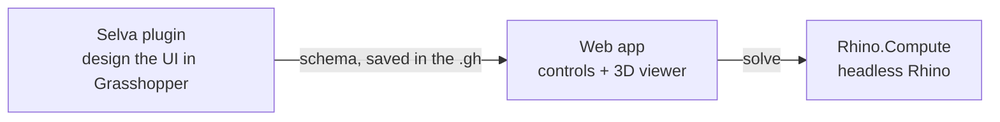

# What is Selva

**Your workflow, everyone's tool.**

A few specialists build a Grasshopper definition. Everyone else needs what it produces, not the canvas. Selva puts a web UI and a live 3D viewer in front of the definition, so colleagues use it through a link. The file stays on your server, and roles decide who can change a definition and who can only run it.

Sending the `.gh` file instead means the recipient needs Rhino and Grasshopper skill, and keeps the method permanently.

Selva is open source (MIT) and free to self-host.

## Two halves

**The plugin** is where you design the interface. Components on the canvas mark which parameters users drive and what comes back. Sliders and toggles become web controls on their own; other components cover dropdowns, color pickers, and file and image uploads. A designer panel, linked to the running Rhino, lets you drag them into tabs and groups. That layout is the **schema**.

**The web app** loads the schema, draws the controls, and solves through **Rhino.Compute**.

One schema drives both. It generates into TypeScript and C#, so the two stay in step.

## Two ways to run the web half

1. **The Selva platform.** `@selvajs/selva` plus the [CLI](./self-hosting/get-started/cli.md) is a ready-made multi-user app with organizations, projects, and roles. Most teams take this path.
2. **Your own app.** The same parts ship as `@selvajs/*` npm packages: a Rhino.Compute client, the 3D viewer, Svelte UI, and provider interfaces. See [Build your own app](./packages/build/overview.md).

Auth, data, and storage are pluggable [providers](./self-hosting/providers/overview.md) either way.

## Next

- [Architecture](./architecture.md)
- [Permissions](./self-hosting/concepts/permissions.md)
- [Get Started](./self-hosting/get-started/overview.md)
